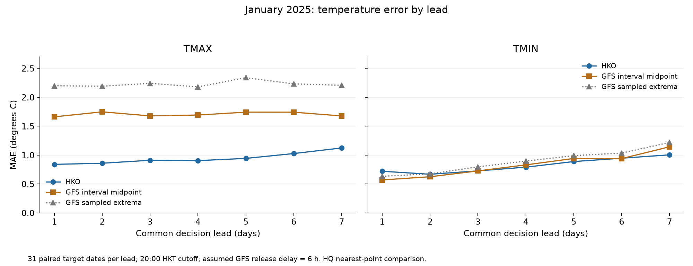
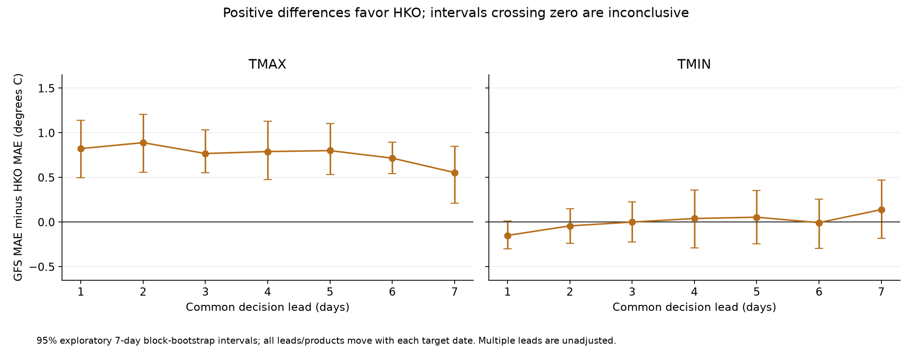
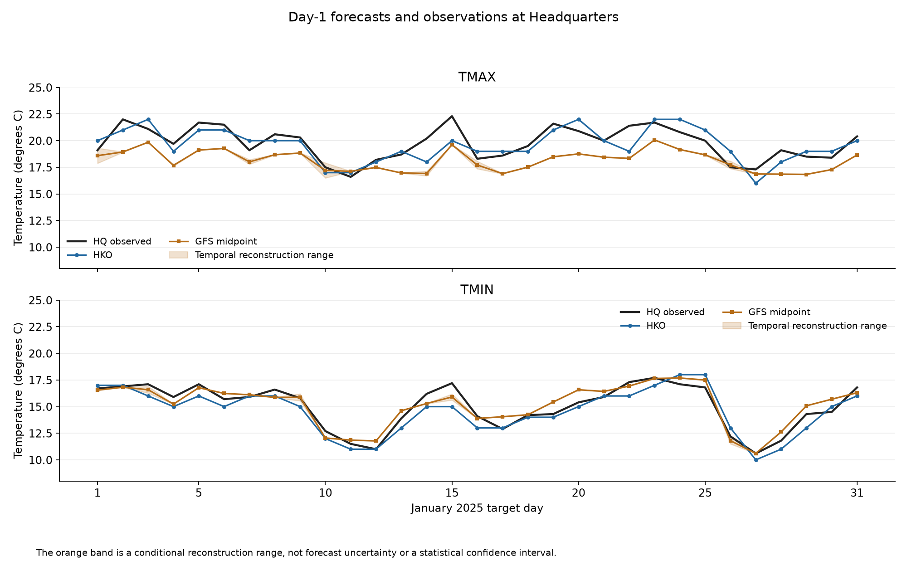
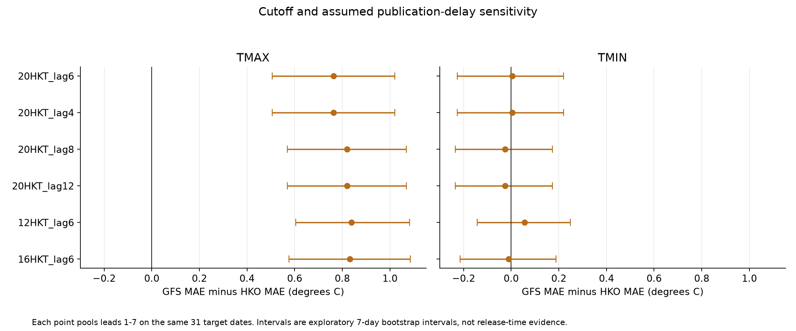
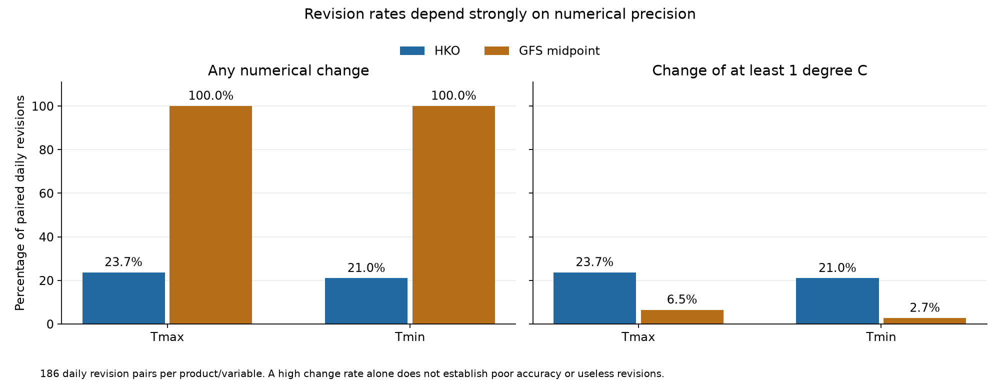

# 一月試行：Tmax 支持 HKO 較準，Tmin 暫無清楚高下

本輪已完成 2025 年 1 月 **溫度的 GFS–HKO 條件式比較**，以及 RH／rainfall
的可比性審計和 HKO 側診斷。GFS RH／rainfall 尚未匯入，這兩類沒有跨產品排名。
數據庫全程唯讀；月份指 **target dates**，包括較早發布的預報。

## 1. 先說能夠得出的結論

- Tmax：HKO MAE **0.943°C**，GFS midpoint proxy **1.705°C**，HKO 平均少
  **0.762°C** 絕對誤差。配對差的 exploratory 95% interval
  是 **[0.505, 1.021]°C**，支持本設計下 HKO 較接近 HQ 觀測。
- Tmin：HKO MAE **0.820°C**，GFS **0.824°C**。差距僅 **0.004°C**，
  interval **[-0.226, 0.220]°C** 包含 0；沒有充分證據判誰較準。
- Tmax 的方向在六個 timing scenarios 和 temporal sensitivity envelope 中保持一致；
  Tmin 的小幅點估計則可換方向，因此不作優勝宣稱。
- GFS native revision rate 是 100%，但只計 ≥1°C 的變動時反而低於 HKO。
  **數值精度必須加入比較規則，不能用「變得較頻密」推斷較不可靠。**

以上只適用於一月、HQ、nearest-grid extraction 和已披露的 reconstruction／availability
假設；不是全年、全港或核心數值模型的整體排名。

## 2. 哪些資料實際可比

| 變量 | HKO 及觀測 | 現有 GFS | 本輪處理 |
| --- | --- | --- | --- |
| Tmax / Tmin | 公開日預報及 31 個完整 HQ 日觀測 | 2m TMP、interval TMAX/TMIN | 以披露的日重建 approximation 配對比較 |
| RHmin / RHmax | 公開預報及 31 份 HQ daily JSON reports | 這次 payload 沒有 RH | 只計 HKO MAE／修訂，不作 GFS–HKO 比較 |
| Rainfall | HKO PSR category、HQ daily amount、22 站 proxy | 這次 payload 沒有 rainfall/probability | 只做 HKO proxy 診斷；PSR 不能直接與 mm 相減 |

缺少匯入變量，並不等於 GFS 模型沒有提供它。Rainfall 即使補到 mm，也仍須處理
probability/event/spatial-definition 的不同；不能直接把 GFS rainfall amount 當成 HKO PSR。
RH daily-report values 是 provisional，沒有 CSV-style completeness flag；日期、範圍與數值檢查通過
不代表已取得 finalized climatological quality certification。

## 3. 本輪採用的比較規則

31 個 target dates × D1–D7 × Tmax/Tmin，共 **434 個 paired cases**，每個變量
217 cases；每個 lead 31 天，並非 217 個獨立天氣日。六個 scenarios 均沒有排除個案。

- 主 cutoff：每日 **20:00 HKT**。HKO 選 bulletin/RSS timestamp 均在截止前的最新版本。
- GFS：主假設 run+6h 才可用，所以選到 06 UTC run；歷史 availability **未核實**。
  HKO timestamp 也只是已知 publication proxy，不是當年的實測接收日誌。
- 主設計 GFS run age 為 6 小時；HKO 公告的中位 age 為 **210.0 分鐘**。
  這回答使用者在同一決策時刻可選哪個產品的條件式問題，不代表兩者資訊年齡相同。
- 地點：HQ 22.301944°N, 114.174167°E；GFS point 22.25°N, 114.25°E，距離 **9.708 km**。
  其他 0.25°產品不一定同樣距離；網格起點、掩膜與定義仍須逐項檢查。
- 只有一個已存檔點，無法從它推回四鄰點，所以這次沒有實作全月 bilinear sensitivity。
  HQ elevation 為 32m，model orography 未驗證，沒有套用事後海拔／bias correction。
- GFS interval 完全 contained 的 union 覆蓋 21h，overlapping union 覆蓋 24h。
  各 endpoint envelope 的 midpoint 作單值；不是 Tmin/Tmax 的平均。
  平均 envelope width：Tmax 0.138°C，Tmin 0.131°C。
  這是處理方法的敏感度範圍，依賴 interval consistency／packing 假設，並非保證界限或 CI。

完整方法及事前固定規則見 [PLAN.md](../PLAN.md)，來源查詢見 [source_queries.sql](../source_queries.sql)。

## 4. 溫度誤差：先分開最高／最低溫

單位 °C；bias=forecast−observed，正數偏高、負數偏低。

| 變量 | 產品 | MAE | RMSE | Bias | Cases |
| --- | --- | --- | --- | --- | --- |
| TMAX | HKO | 0.943 | 1.136 | -0.153 | 217 |
| TMAX | GFS midpoint proxy | 1.705 | 1.908 | -1.562 | 217 |
| TMIN | HKO | 0.820 | 1.006 | -0.077 | 217 |
| TMIN | GFS midpoint proxy | 0.824 | 1.028 | 0.243 | 217 |

GFS Tmax 在這個月的最近格點有約 −1.562°C 平均 bias。這是觀察到的模式，不能直接歸因於
海岸、地形或模型本身。沒有以一月觀測估 offset 再回頭評同一月，避免訓練／測試混用。

| Lead | Tmax HKO | Tmax GFS | Tmin HKO | Tmin GFS |
| --- | --- | --- | --- | --- |
| 1 | 0.839 | 1.661 | 0.719 | 0.569 |
| 2 | 0.858 | 1.747 | 0.668 | 0.624 |
| 3 | 0.910 | 1.677 | 0.726 | 0.725 |
| 4 | 0.903 | 1.692 | 0.790 | 0.830 |
| 5 | 0.942 | 1.742 | 0.887 | 0.941 |
| 6 | 1.026 | 1.741 | 0.945 | 0.938 |
| 7 | 1.123 | 1.677 | 1.003 | 1.142 |

D1 的 Tmin 點估計是 GFS 較低；D7 則是 HKO 較低。完整配對 intervals 如下，
不把單一 lead 的點估計或 31 天結果當穩定排名。
HKO Tmax 的 D1→D7 MAE 由 0.839 升至 1.123°C；GFS 則由 1.661 至 1.677°C，
中間亦有升跌。本月不支持「兩產品每增加一個 lead 都一定更差」的單調描述。

如果只取八個 instantaneous samples 的極值，GFS Tmax MAE 是 **2.227°C**，
而 interval-midpoint 是 **1.705°C**。僅資料處理就改變約 **0.521°C**，顯示 inconsistency
的處理確實影響比較。instantaneous sampled Tmax 不能直接冒充完整日 Tmax。

主設計下，GFS 誤差相對 HKO 的 temporal sensitivity envelope 是 Tmax
**[0.698, 0.831]°C**、Tmin
**[-0.049, 0.070]°C**。
它不是抽樣 CI；甚至讓每個 case 選有利 endpoint，Tmax 平均方向仍支持 HKO。
這只是 conditional conservative envelope，不宣稱所有 case endpoint 能由同一模型路徑同時實現。

## 5. Timing 與 baseline 敏感度

每格為 GFS MAE−HKO MAE 和 7-day exploratory 95% interval，單位 °C。

| Scenario | Tmax ΔMAE [CI] | Tmin ΔMAE [CI] |
| --- | --- | --- |
| 20HKT_lag6 | 0.762 [0.505, 1.021] | 0.004 [-0.226, 0.220] |
| 20HKT_lag4 | 0.762 [0.505, 1.021] | 0.004 [-0.226, 0.220] |
| 20HKT_lag8 | 0.821 [0.570, 1.068] | -0.026 [-0.234, 0.173] |
| 20HKT_lag12 | 0.821 [0.570, 1.068] | -0.026 [-0.234, 0.173] |
| 12HKT_lag6 | 0.838 [0.605, 1.082] | 0.057 [-0.143, 0.249] |
| 16HKT_lag6 | 0.832 [0.577, 1.086] | -0.011 [-0.214, 0.188] |

4h／6h 假設選到相同 cycle；8h／12h 亦選到相同 cycle，兩兩相同並非四份獨立證據。
三日 block sensitivity 也保留在 CSV；月份只有 31 日，對 7-day blocks 的有效資訊量很有限。

baseline 延續 Task 1 的 frozen 1991–2020 ±2-calendar-day mean，以及 decision date−2
的 retrospective persistence。MAE skill=1−forecast MAE/baseline MAE，正數較 baseline 準。

| Variable | Product | Baseline | MAE skill |
| --- | --- | --- | --- |
| TMAX | hko | climate | 0.338 |
| TMAX | gfs | climate | -0.198 |
| TMAX | hko | persistence | 0.523 |
| TMAX | gfs | persistence | 0.138 |
| TMIN | hko | climate | 0.502 |
| TMIN | gfs | climate | 0.499 |
| TMIN | hko | persistence | 0.665 |
| TMIN | gfs | persistence | 0.663 |

GFS Tmax 本月沒有勝過所選 climatology baseline；這不代表全年都沒有 skill。

## 6. Revision rate、幅度及 usefulness

同一 target date 相鄰 decision day，兩產品每天各選一次，D(k+1)→Dk，k=1–6。
每產品／變量 186 pairs，只有 31 個 target dates。Native change threshold=1e−10
僅去除浮點噪聲；另以 ≥1°C 呈現共同的 material threshold。

| Variable | Product | Pairs | Any change | ≥1°C | MAR °C | Changed-only improved | Mean U all °C | U 95% interval |
| --- | --- | --- | --- | --- | --- | --- | --- | --- |
| TMAX | HKO | 186 | 23.7% | 23.7% | 0.247 | 56.8% | 0.047 | [-0.011, 0.095] |
| TMAX | GFS | 186 | 100.0% | 6.5% | 0.405 | 51.1% | 0.003 | [-0.063, 0.065] |
| TMIN | HKO | 186 | 21.0% | 21.0% | 0.215 | 61.5% | 0.047 | [0.014, 0.081] |
| TMIN | GFS | 186 | 100.0% | 2.7% | 0.346 | 58.1% | 0.096 | [0.067, 0.119] |

U=舊絕對誤差−新絕對誤差，正數表示改善。changed-only improved 的分母只包含 changed cases；
Mean U all 則包含所有 186 pairs，不可把兩者混成同一指標。
Tmin 的兩產品 mean U intervals 均支持正方向；Tmax 的 intervals 均跨 0。
GFS Tmax 平均改善約 0.003°C，不能形容為已證明修訂有明顯幫助。

HKO 公開溫度以整數為主，GFS 保留更細精度。因此 native 100% change rate 本身不是
穩定性優劣的充分判據。MAR、FFI 和 ≥1°C change rate 必須一同閱讀。
FFI 公式沿用 Task 1，Tmax HKO/GFS 約 0.090/0.236°C，Tmin 約 0.052/0.180°C；
它描述軌跡折返程度，不表示修訂是否準確，也沒有消除 reporting-precision 差異。

## 7. RH 與 rainfall：完成可比性審計，保留 HKO 側結果

RH errors 用 percentage points（pp），不是相對百分比。

| HKO variable | MAE pp | RMSE pp | Bias pp | Cases |
| --- | --- | --- | --- | --- |
| rh_min | 6.336 | 7.908 | 1.682 | 217 |
| rh_max | 4.908 | 6.528 | -0.373 | 217 |

HKO RH 的 daily revision rate：約 RHmin 30.1%、RHmax 31.2%；changed-only improved 約
64.3%／56.9%。完整 lead／revision 表見 CSV。因 GFS RH 未匯入，以上不是模型間比較。

Rainfall 的 22-station proxy 在 **31 個可用日中沒有 ≥10mm event**，HQ point 也沒有。
217 個選中 HKO PSR 全是 Low，186 次 daily revisions 的 category change rate 是 0%。
以 Low midpoint=0.15 編碼的 Brier score 是 **0.0225**；相容 band-score
bounds 是 **[0.000, 0.090]**，不是 CI。
全為 non-events 時，always-no-event baseline 的 Brier score 就是 0；所以不能用小 Brier score
或零修訂率宣稱 PSR 完美／已證明校準，也無法估計 event hit rate。

HQ numeric rainfall sum=4.2mm；5 個 Trace 值保留 [0,0.05)mm，因此研究用總量區間為
[4.2,4.45)mm，而非把 Trace 靜默變成 0。這與官方公布 4.2mm 的 reporting convention 不矛盾。

## 8. 樣本涵蓋及最終可說的話

[HKO 一月天氣摘要](https://www.hko.gov.hk/en/wxinfo/pastwx/mws2025/mws202501.htm)
記錄本月以乾燥東北季候風為主、雨量 4.2mm，並有冷空氣過程；南海及西北太平洋沒有熱帶氣旋。
所以「一月沒有颱風／大雨測試樣本」屬月份本身的範圍限制，不是這次漏掉那些日期。

**可以說：**這個月、HQ、指定 timing／nearest-grid／daily-proxy 下，Tmax 支持 HKO 較準，
Tmin 沒有清楚優勝者。配對流程、lead errors 和 daily revision 指標已跑通。

**仍不能說：**HKO 全年一定較準；GFS 在所有地點都偏低；已控制核心模型能力或地形因果；
RH/rain 已完成 GFS–HKO 比較；或本研究已驗證颱風／暴雨情況。

擴展全年前，優先補上：GFS RH/rain 的相應資料與共同事件定義、若要 bilinear 則重取鄰點、
以及維持歷史 availability 的情景限制。[ESMF 方法說明](https://earthsystemmodeling.org/regrid/)
指出 bilinear 是局部線性插值、conservative regridding 保留場的面積積分；兩者用途不同，
不能當成可互換的通用修正，也不會自動恢復高度／海陸差異。

## 9. 核對與重現

6,373 項獨立檢查通過：重算全部 case／score／revision 算術、
2,604 個 daily reconstructions，以及主 paired interval。
另一套 live SQL 對 1,302 個 vintage selections 全數核對，錯配 0。
同一 ending time 的 instantaneous／min／max 經各自 packing padding 後，一致性警示為
0。這些核對不會把 conditional envelope 變成保證界限。

來源與 hash 見 [run_metadata.json](run_metadata.json)，檢查範圍見 [verification.json](verification.json)。
原始唯讀 snapshot 留在被 Git 忽略的 cache/；結果 CSV 是研究派生配對／彙總，沒有 credentials。
因沒有資料庫修改，本輪不需要刷新 schema snapshot。
