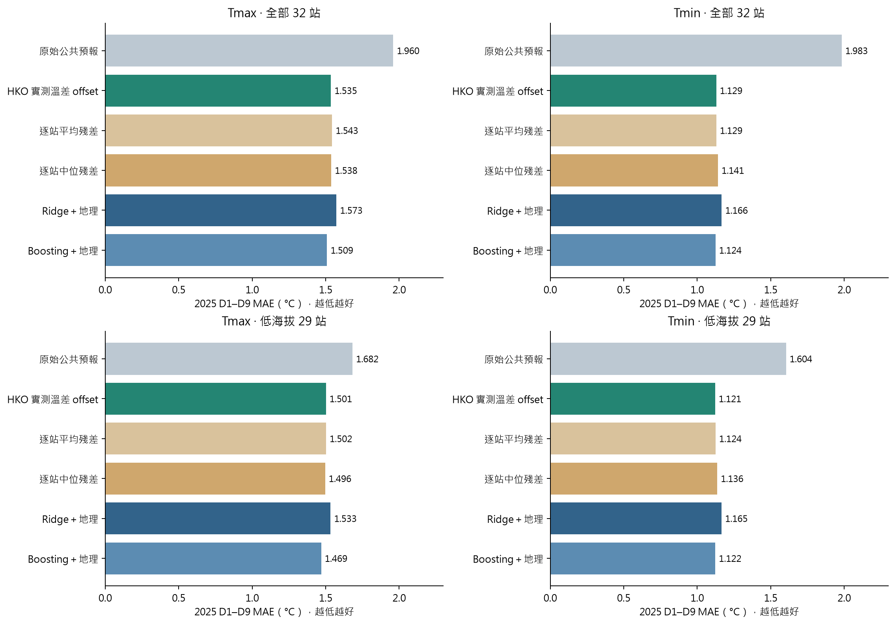
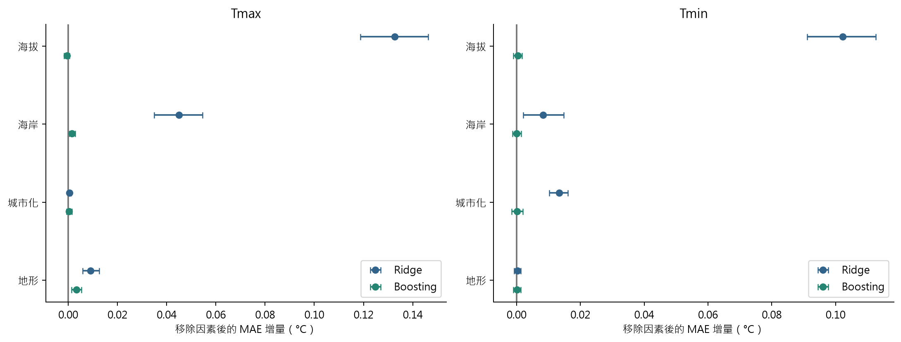

# 圖 11／12 與模型設定閱讀指南

## 圖 11：比較哪個方法的 MAE 較小

同一面板使用相同 2025 D1–D9 案例，柱越短表示平均絕對誤差越小。上排全部 32 站，下排低海拔 29 站。

| 方法 | 修正值從哪裡來 |
|---|---|
| 原始公共預報 | 不加地方修正 |
| HKO 實測溫差 offset | 歷史「地方實測 − HKO 實測」；Tmax 月平均、Tmin 月中位數 |
| 逐站平均殘差 | 歷史「地方實測 − 公共預報」平均，按站點及 lead 分開 |
| 逐站中位殘差 | 同上，但取中位數 |
| Ridge＋地理 | 用預報、lead 和地理特徵的線性組合預測殘差 |
| Boosting＋地理 | 用多棵小型決策樹逐步預測殘差 |

ML 的公式為 `r = O − F`、`F̂ = F + f(X)`。模型沒有把 HKO offset 當成額外輸入，因此兩者要分開標示。微小分數差仍需看配對區間。

## 使用的 8 個輸入

| 組別 | 數值 |
|---|---|
| 基本輸入 | 公共氣溫預報、lead（D1–D9） |
| 海拔 | 站址海拔 m |
| 海岸 | `log(1 + 海岸距離 km)` |
| 城市化 | 500 m 較窄開發用途比例 |
| 地形 | 坡度、TPI z、500 m 局部高差 |

ML 使用連續地理值，不是只使用「近海／內陸」等群組標籤。這些模型沒有加入行政區、季節或目標日實測天氣。報告另有加入行政區的誤差解釋模型，與此預報模型不同。

## 圖中最終參數

以下為已知站跨年份氣溫實驗；Tmax 和 Tmin 的選擇相同。

| 設定 | 候選／固定方式 | 選用值 |
|---|---|---:|
| Ridge α | 比較 1、100、10000 | 1 |
| Boosting 最大葉節點 | 比較 7、15 | 15 |
| Boosting 訓練輪數 | 固定 | 80 |
| 學習率 | 固定 | 0.07 |
| 每葉最少樣本 | 固定 | 150 |
| L2 正則化 | 固定 | 1 |
| Early stopping | 固定 | 關閉 |
| Random seed | 固定 | 3522 |

Ridge 的輸入先標準化，訓練目標是加正則化的平方誤差；氣溫 Boosting 採絕對誤差損失。均以站點×lead 權重平衡訓練資料。

用 2022–2023 訓練、2024 選參數，再用 2022–2024 重訓、2025 評估。低海拔版本重訓但不重新調參。記錄：[Tmax](report/results/Tmax_selection.csv)、[Tmin](report/results/Tmin_selection.csv)；程式：[run_models.py](source/11_geographic_factors/run_models.py)。

## 圖 12：移除因素後，模型會不會變差？

橫軸 = **移除因素並重新訓練後的 MAE − 使用全部因素的 MAE**。

以左圖 Ridge 的海拔為例：完整模型 MAE 約 1.573°C；拿走海拔後約 1.706°C；差值約 +0.133°C，所以點在零右側，表示海拔對此模型有額外預測資訊。

- 點在零右側：拿走後變差。
- 點接近零：拿走前後差不多。
- 點在零左側：拿走後反而較好。
- 橫線跨過零：目前不足以確定穩定的額外改善。

藍點是 Ridge，綠點是 Boosting；這張圖的顏色不是 offset 前後。「地形」一列同時移除坡度、TPI 及局部高差三個輸入。實驗使用全部 32 站，每次保留既有參數、移除一組因素並重新訓練。

綠點接近零不能直接說地理因素沒有用；其他相關輸入可能提供相近資訊。此圖衡量模型內的額外資訊，不是因果效果、可相加的百分比，亦不直接比較哪個完整模型較準。

## 海岸圖的藍線、綠線及 r

藍點／線使用原始公共預報的逐站 MAE，綠點／線則使用 HKO offset 後的逐站 MAE。每個版本各自以站點等權 OLS 擬合 `MAE = a + b × 距海岸 km`，綠線不是把藍線整條下移。

`r` 是這些站點「距離與 MAE」的 Pearson 相關係數，不是準確率。線的高度描述誤差大小，斜率描述每公里的平均關聯，r 描述點與線性關係的一致程度。r 可增加而斜率與 MAE 同時下降；不能只按 r 判斷預報好壞。
