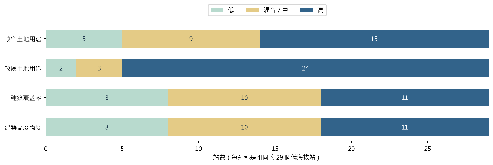
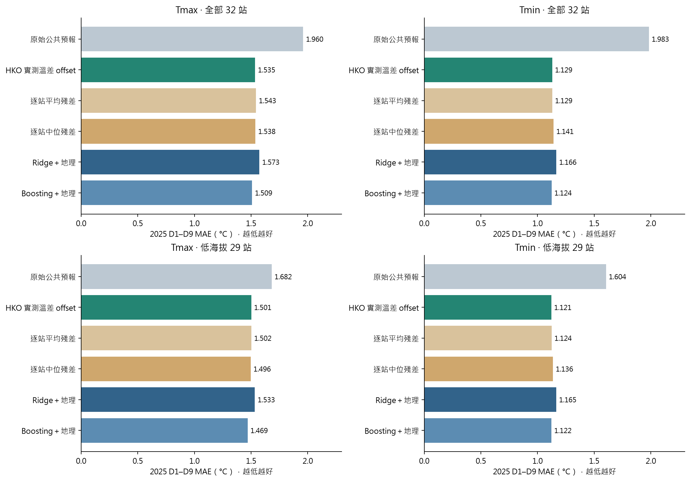

# Findings：地方校正與地理差異

## 1. HKO 是有資料支持的參考假設

[2012 年立法會答覆](https://www.info.gov.hk/gia/general/201202/22/P201202220231.htm)說明歷來以尖沙咀總部的氣象數據作為天氣報告及預報指標。[現行 HKO 首頁](https://my.weather.gov.hk/tc/index.html)的說明支持當日最高／最低溫顯示以天文台為參考，但未完整確認本研究歷史 D1–D9 所有欄位的空間定義。

在 2025 D3、每站與 HKO 配對的共同有效日中，32 站有 31 站的 Tmax MAE、32 站的 Tmin MAE 高於 HKO。這與參考假設相容，不能單獨證明官方預報定義。[逐站結果](report/deepening/results/hko_offset/hko_same_date_reference.csv)

## 2. 歷史地方溫差校正有用

Offset 學習訓練期同日的「地方實測 − HKO 實測」。用 2023／2024 時序驗證選方法，再以 2022–2024 重估後固定，評估 2025。Tmax 採月別平均溫差，Tmin 採月別中位溫差。

| 站群 | 變量 | 原始 MAE | 校正後 MAE | 改善 |
|---|---|---:|---:|---:|
| 全部 32 站 | Tmax | 1.960°C | 1.535°C | 21.6% |
| 全部 32 站 | Tmin | 1.983°C | 1.129°C | 43.0% |
| 低海拔 29 站 | Tmax | 1.682°C | 1.501°C | 10.7% |
| 低海拔 29 站 | Tmin | 1.604°C | 1.121°C | 30.1% |

2025 D1–D9，同案例、站點×lead 等權。低海拔 Tmax 有 3 站平均變差，Tmin 的 29 站均改善；不能把整體改善說成每站改善。[完整效果與區間](report/deepening/results/hko_offset/benefits.csv)

## 3. 高站差異明顯，低海拔內沒有一致高度趨勢

海拔分為 <200 m、200–<700 m、≥700 m，分別 29、2、1 站。三個高站為大老山 TC（572 m）、昂坪 NGP（593 m）、大帽山 TMS（955 m）。低組實際為 4–142 m；採 200 或 300 m 門檻不改變這批站的歸組。

2022–2025 D3 中高組的原始 MAE 明顯較高，但低海拔內分組與連續高度沒有一致的誤差遞增關係。高站只有三個，不能把結果當成普遍海拔定律。[分組資料](report/deepening/results/group_means.csv)

## 4. 海岸分組和連續距離均有正向關聯

低海拔 29 站的內陸減近海 MAE 差：

| 期間／處理 | Tmax | Tmin |
|---|---:|---:|
| 2022–2025 D3 原始 | 0.715°C | 0.642°C |
| 2025 D3 原始 | 0.771°C | 0.755°C |
| 2025 D3 HKO offset 後 | 0.381°C | 0.468°C |

每個站對只比較自身共同日，再對站對等權。只有同一批 2025 案例的前後差，才可用來判斷 offset 效果。[原始分組](report/deepening/results/matched_contrasts.csv)／[校正前後](report/deepening/results/hko_offset/coast_contrasts.csv)

不分組、直接使用海岸距離公里數，低海拔站控制同日差異後：

| 變量 | 原始斜率 | Offset 後斜率及 95% 區間 |
|---|---:|---:|
| Tmax | 0.130°C/km | 0.068 [0.046, 0.090]°C/km |
| Tmin | 0.123°C/km | 0.071 [0.045, 0.101]°C/km |

再考慮其他地理因素和四大區後，校正後斜率仍約為 +0.060／+0.057°C/km。這是現有站群的平均關聯，不是每公里的因果效果。低海拔只有四個站距海岸超過 2 km；全站共同有效日期太少，因此散點圖、同日模型與共同日敏感度分開報告。[線性模型](report/deepening/results/hko_offset/continuous_coast_date_regressions.csv)／[逐站移除](report/deepening/results/hko_offset/continuous_coast_leave_one_station_out.csv)

## 5. 城市化結論對定義敏感

同一批低海拔 29 站按較窄土地用途分組時，低／混合／高有 5／9／15 站；較廣土地用途則為 2／3／24。建築覆蓋率和高度強度各為 8／10／11，且使用不同門檻。

2022–2025 D3 Tmin 的低組減高組 MAE，較窄用途約 +0.317°C，較廣用途約 −0.341°C。這是比較群體改變，不是同一群站的表現反轉。主要定義下的校正後聯合模型已完成；其他城市化定義的 offset 後重跑仍待補做。[定義比較](report/deepening/results/matched_contrasts.csv)

## 6. Correlation 與 ML 回答不同問題

地理特徵的 Spearman 矩陣每站只計一次。低海拔海拔與坡度、相對地形位置的相關約 +0.68／+0.69，提示特徵存在重疊；相關不代表因果。[相關矩陣](report/deepening/results/factor_correlations.csv)

2025 D1–D9，既有 ML 學「地方實測 − 公共預報」殘差。Ridge／Boosting 使用公共預報、lead 及六個地理數值。低海拔模型已在低海拔訓練資料重新擬合，沿用驗證參數。[模型分數](report/deepening/results/hko_offset/restored_ml_display_scores.csv)

Boosting 相對 HKO offset 的 MAE 差：全部站 Tmax／Tmin 約 −0.026／−0.005°C；低海拔約 −0.032／+0.001°C。四個配對 95% 區間均跨零，不能說複雜模型穩定較好。[配對比較](report/deepening/results/hko_offset/restored_ml_vs_hko.csv)

因素移除實驗衡量「拿走這組輸入並重訓後，MAE 增加多少」，不是因果貢獻。Ridge 對海拔及海岸資料較敏感，Boosting 的額外增量多較小。[因素移除](report/results/factor_drop_comparisons.csv)

## 限制與仍需補做

- 歷史九天預報欄位的正式空間定義仍需更直接的文件。
- 高站 3 個、低海拔內陸站 4 個，限制對其他站點的推廣。
- 14 日、2,000 次的日期區塊區間固定站群及訓練結果，沒有涵蓋所有空間依賴或訓練不確定性。
- 地理資料使用固定年份；未逐年重建城市發展及海岸變化。
- 2025 已被既有研究分析，屬回顧性評估；仍需新的年份驗證。
- 本次 HKO offset 只適用於氣溫，不能直接套用到 Rainfall。
