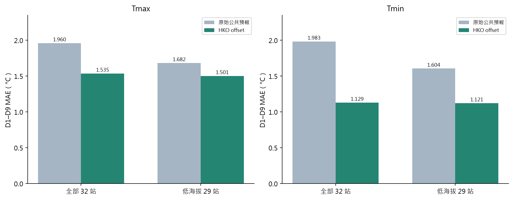
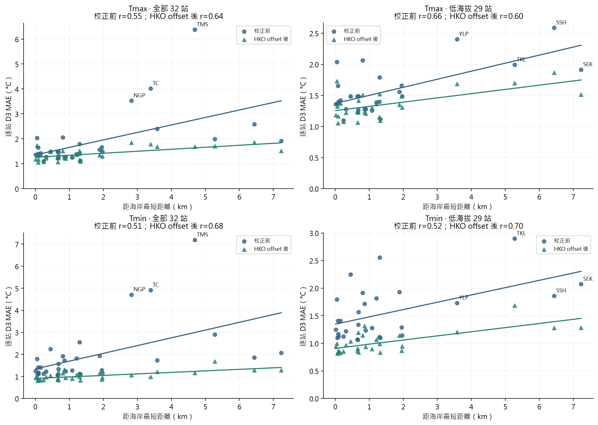

# 香港氣溫預報：HKO 參考點、地方校正與地理因素

本目錄集中保存研究結果、findings、正式報告及程式，供檢查後再提出 PR。主要比較 **全部 32 個自動氣象站**與**低於 200 m 的 29 站**；原研究 30 站只保留在附錄。

## 從這裡開始

- [研究發現與證據](FINDINGS.md)：GitHub 可直接閱讀的重點、數值與限制。
- [正式 HTML 報告](report/deepening/index.html)：完整敘事、12 張圖及 caption。GitHub 會顯示 HTML 原始碼；下載本目錄或 repository 後，以瀏覽器開啟此檔案。圖像已嵌入，可離線閱讀。
- [圖表與方法閱讀指南](FIGURE_GUIDE.md)：圖 11／12、六種方法、8 個輸入與最終參數。
- [主要氣溫結果 CSV](report/deepening/results/hko_offset)：HKO offset、連續海岸距離、多因素分析及 ML 比較。
- [既有 Temperature／Rainfall 完整報告](report/index.html)及[地理深化技術附錄](report/deepening/technical_appendix.html)：保留前期研究脈絡。

研究主線：**HKO 參考依據 → 驗證地方溫差校正 → 海拔與海岸差異 → 連續距離 → 城市化與相關性 → ML 是否有額外改善。**



2025 年 D1–D9；相同站群內使用相同案例，對站點及提前天數等權平均。低海拔最高／最低溫 MAE 改善約 10.7%／30.1%。



2025 年 D3；每點一站，直線為描述性 OLS。各站有效日期不同，因此另有控制同日差異的模型，不能單憑圖線推論因果。

## 內容配置

| 位置 | 內容 |
|---|---|
| `report/deepening/` | 當前正式報告、圖表、最新結果及來源 |
| `report/results/` | 原始地理比較、ML、因素移除、Rainfall 等前期結果 |
| `source/11_geographic_factors/` | 地理資料、氣溫／雨量模型與獨立驗證程式 |
| `source/12_geographic_deepening/` | 低海拔深化、城市化定義、分區及相關分析 |
| `source/13_hko_offset_reframing/` | HKO offset、連續海岸距離、ML 配對比較及當前報告生成器 |
| `reference/legacy_hko_offsets/` | 原研究 30 站的選擇結果、2025 成績及訓練 offset |
| `verification/` | 本次發佈包的連結、數值、檔案及瀏覽器核對 |

## 資料及解讀範圍

氣溫使用 2022–2025 年 HKO 公共預報及完整性標記 C 的日最高／最低溫實測。原始地理分組主要比較 2022–2025 D3；offset、連續海岸距離及 ML 的主要評估年份為 2025。HKO 總部另作參考，不包含在 32 個 AWS 中。

本研究衡量同一份公共預報在不同地點的適用程度，以及研究建立的地方校正效果。它不是各站原生預報模型之間的競賽；相關性、線性斜率、移除因素後的預測增量也不是因果效果。

2025 沒有用來訓練本次 offset 或挑選原模型參數，但已在既有研究中分析過，因此屬回顧性的跨年份評估。區間主要固定站群及模型，只重抽日期，不涵蓋所有空間、訓練或地理資料的不確定性。

## 重建圖表及報告

從本目錄執行：

```powershell
python rebuild_report.py --output C:/path/to/new-report-output
```

此指令使用包內結果表重新產生圖表與 HTML，不連接資料庫、不重新訓練模型。需要 pandas、numpy、matplotlib；中文字型需 Microsoft JhengHei 或 Noto Sans CJK TC。經原研究 Python 環境驗證。輸出路徑必須是尚未存在的新目錄。

完整重算分析另需原始 CSV、GIS 資料及個案層級預測檔；這些大檔和任何資料庫憑證沒有放入此發佈包。原始分析程式保留原環境的檔案布局及路徑，供追溯；並不聲稱在乾淨 checkout 中能直接完成所有模型訓練。所用資料雜湊及各階段驗證結果保留於 metadata 和 verification 檔案。

`SOURCE_SNAPSHOT_HASHES.json` 記錄複製後、可攜性修改前的檔案雜湊；`MANIFEST.json` 記錄最終發佈檔案。報告生成器只增加明確輸出路徑和字型相容設定，數值分析未因發佈而改動。

## 驗證

- 原研究 30 站分數及 2,160 列 offset 已重現。
- 2025 個案由原始預報及完整實測獨立核對。
- 連續距離的 24 個同日模型係數已獨立驗算。
- ML 與 HKO offset 的 16 個配對比較使用相同實測及個案。
- 當前 HTML 的 12 張圖、caption、正文 32／29 站範圍及桌面／手機版已檢查。

詳細結果見 [數值核對](report/deepening/results/hko_offset/verification.json)、[連續距離核對](report/deepening/results/hko_offset/continuous_coast_metadata.json)、[ML 配對核對](report/deepening/results/hko_offset/restored_ml_verification.json)及 [HTML 核對](report/deepening/qa/hko_offset/browser_verification.json)。
