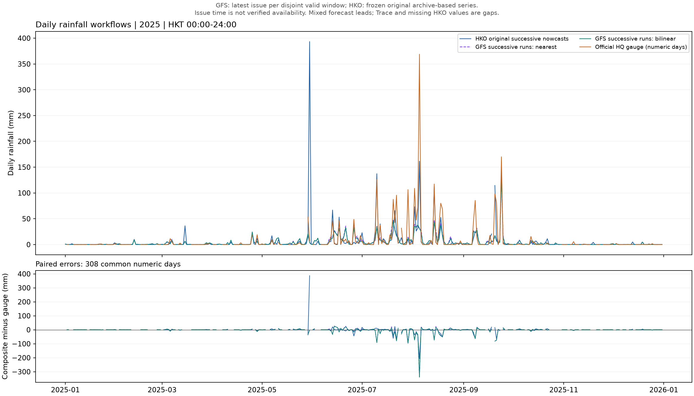
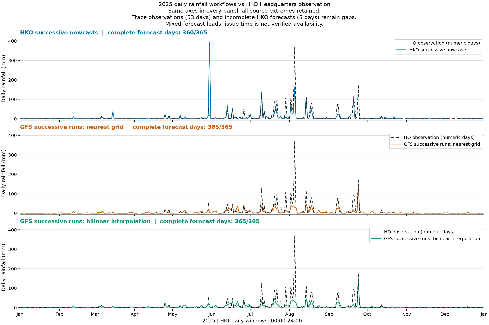

# 2025 香港每日雨量：HKO 與 GFS 預報流程比較

Task 2 exploratory case study｜2026-11-14｜Reference：HKO Headquarters（HQ）每日實際雨量。

## 結果摘要

**HKO 的平均絕對誤差較低，GFS 的 RMSE 較低，未能判定整體勝負。** 主分析使用同一批 **308 個有明確數值觀測且三份預報均完整的日期**。HKO／GFS nearest／GFS bilinear 的 MAE 分別為 **5.578／6.666／6.665 mm**。兩種 GFS 方法與 HKO 的 MAE 差異，其 95% CI 均包含零。這不代表三者等效。

這是 **daily workflow comparison**：把 HKO successive nowcasts 與 GFS successive runs 各自組成日雨量，再與 HQ gauge 比較。更新頻率、forecast lead 及選版規則不同，**不能解讀為相同 lead time 的模型能力、兩小時 forecast accuracy，或整個 agency 的排名**。

## 比較方法

- **日期與 truth：**2025-01-01 至 2025-12-31；每日 HKT 00:00–24:00；HQ climate gauge 為共同 reference。
- **HKO：**沿用既有 gridded-rainfall nowcast daily composite，沒有重建。選取 HQ 附近 2 km grid（22.304°N、114.182°E），距 HQ 約 0.84 km。原流程按 hourly archive sampling，要求 capture 不晚於 native window 起點，再選 eligible vintages 的最新 issue。切分原 half-hour windows 時採均勻雨強分配。
- **GFS：**使用每日 02:00、08:00、14:00、20:00 HKT 起報的 runs。每段選最新 `issue_time ≤ valid_start`。Issue 指 initialization time，**不等於實際 available time**；沒有核實當年的發布延遲。
- **空間：**nearest 使用 22.25°N、114.25°E，距 HQ 約 9.71 km。Bilinear 由四個包圍格點插值至 HQ（22.301944°N、114.174167°E），再加總日雨量。兩者均為 grid-to-station proxy；高度及空間代表性差異仍存在。

### GFS 如何避免重複累計

`C(k)` 是所選同一 run 從起報累積至 +k 小時的 APCP；`C(0)=0`。kg/m² 對應 mm 水深。

| 不重疊 valid window（HKT） | 所選 run（HKT） | 該段雨量 |
|---|---|---|
| 00:00–02:00 | 前日 20:00 | C(6) − C(4) |
| 02:00–08:00 | 當日 02:00 | C(6) |
| 08:00–14:00 | 當日 08:00 | C(6) |
| 14:00–20:00 | 當日 14:00 | C(6) |
| 20:00–24:00 | 當日 20:00 | C(4) |

每段兩個 endpoints 均來自同一 run。五段合計 24 小時，沒有 overlaps 或 gaps。直接使用原始 +4h／+6h 欄位，**GFS 無須時間插值或均勻雨強假設**。全年包含 1,461 runs（含年初 padding）、1,825 windows，365 日完整；沒有負雨量增量。

## 共同日期的誤差

以下全部使用 **308 common numeric days**。Bias = composite − observation；ΔMAE = 該方法 MAE − HKO MAE。單位均為 mm，數值越接近零的 bias 不一定代表 MAE 越小。

| Daily composite／baseline | MAE | RMSE | Bias | ΔMAE vs HKO（95% CI） |
|---|---:|---:|---:|---:|
| HKO successive nowcasts | 5.578 | 27.640 | −1.221 | Reference |
| GFS successive runs：nearest | 6.666 | 24.413 | −3.112 | +1.088（−2.166–+3.468） |
| GFS successive runs：bilinear | 6.665 | 24.483 | −3.390 | +1.088（−2.174–+3.483） |
| Zero-rain diagnostic baseline | 7.753 | 29.650 | −7.753 | +2.175（−1.229–+5.230） |

CI 使用配對 7-calendar-day circular block bootstrap，2,000 draws，seed 3522。保留整年 calendar slots，再於每次抽樣使用共同有效日期。它反映這一年日期變異，不代表跨年份不確定性。未另外計算 RMSE 差異的 CI。

**Nearest 與 bilinear 的平均 MAE 幾乎相同。** Bilinear − nearest = −0.000164 mm，95% CI [−0.107, +0.114] mm，沒有明確優勢。

**Coverage 與 Trace：**HQ 有 312 numeric days、53 Trace days。Trace 保留為 [0, 0.05) mm，沒有當作零或一般缺失。HKO 有 360 個完整 forecast days；共同 numeric days 為 308。共同 complete days 為 360，包含 52 個 Trace days；其 MAE censoring bounds 為 HKO 4.823–4.830、GFS nearest 5.873–5.881、GFS bilinear 5.851–5.859 mm。這些是誤差上下界，並非 CI。

**Missingness：**HKO 不完整日期為 9/19、9/24、10/30、12/6、12/10。其中 9/24 的 HQ 雨量為 170.1 mm。不能假設缺測與天氣無關；這是 archive／replay coverage，不代表機構服務 availability。GFS 單獨使用全部 312 numeric days 的 MAE 為 6.707／6.706 mm，不與 308-day HKO 結果直接比大小。

**極端值影響：**5/30 HKO composite 為 393.384 mm，HQ 為 6.4 mm。Primary analysis 保留該值。僅作 post-hoc sensitivity 而移除該日時，307 common days 的 HKO／GFS nearest／bilinear RMSE 為 16.693／24.453／24.522 mm。RMSE 結論對該日敏感；這不足以判定該值無效。

## 全年圖表

原圖保留：上半為所有可用日值；下半 errors 僅使用同一批 308 common numeric days。



清晰版放在原圖下方。HKO（藍）、GFS nearest（橙）、GFS bilinear（綠）分開面板，以黑色虛線對照 HQ observations。三圖共用尺度，保留所有極端值；Trace observations 與不完整 HKO forecast 日留空。



## 如何核對與重現

| 檔案 | 內容 |
|---|---|
| [daily_comparison.csv](daily_comparison.csv) | 365 日 forecasts、HQ truth、Trace 原文與完整性 flags |
| [gfs_valid_windows.csv](gfs_valid_windows.csv) | 1,825 段的 issue／valid windows、雨量及 NOAA source URLs；available time 留空 |
| [results.json](results.json) | 未四捨五入的 metrics、CI、Trace bounds、sensitivity 與 inputs hashes |
| [original_grib_controls.json](original_grib_controls.json) | 六個原始 NOAA messages 的四格核對，涵蓋 cycles 及年界 |
| [validation.json](validation.json)、[clear_plot_validation.json](clear_plot_validation.json) | 原分析與清晰版圖的歷史 checks；其中 workspace-relative paths 為 provenance |
| [publication_manifest.json](publication_manifest.json) | 本次上傳檔案的 SHA-256 |
| [reproduce.py](reproduce.py) | 由固定 CSV 重算 metrics／CI／bounds，核對 windows；可重畫清晰版 |

在本目錄執行：

```bash
python -m pip install -r requirements.txt
python reproduce.py
python reproduce.py --plot
```

`--plot` 另存 `reproduced_comparison.png`，保留兩張發布圖。檢查不需要 database 或網路。可重現範圍是 **已凍結 CSV → 指標／CI／圖表**；本目錄沒有打包完整 raw archives、1,461-run four-cell cache 或 HKO 原始 replay pipeline，不能單靠它從 raw sources 重建 HKO／GFS composites。六個 GRIB controls 是 spot checks，並非逐檔驗證全年 NOAA originals。`validation.json` 的 script／report hashes 對應當時 workspace 版本，不是此精簡發布版本。

## 解讀限制與來源

這是一年、單站、已探索過資料的 workflow case study。兩種產品的更新頻率、lead、選版 eligibility、spatial support 不同。HKO 保留原 capture eligibility；GFS 只按 issue time 選版。因此結果不能證明相同實際 cutoff 下誰較準，也不能外推至其他年份或整個香港。Bilinear 不會消除粗網格與 station observation 的尺度差異。

資料及產品背景：[NOAA GFS](https://www.emc.ncep.noaa.gov/emc/pages/numerical_forecast_systems/gfs.php)、[GFS virtual archive](https://dynamical.org/catalog/noaa-gfs-forecast-virtual/)、[HKO rainfall nowcast](https://data.gov.hk/en-data/dataset/hk-hko-rss-gridded-rainfall-nowcast-in-hong-kong)、[HQ 每日氣候資料](https://www.hko.gov.hk/en/cis/dailyExtract.htm)。實際使用的固定 inputs、source hashes 與逐段 NOAA URLs 以上述 artifacts 為準。
