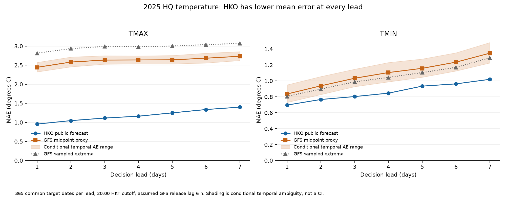
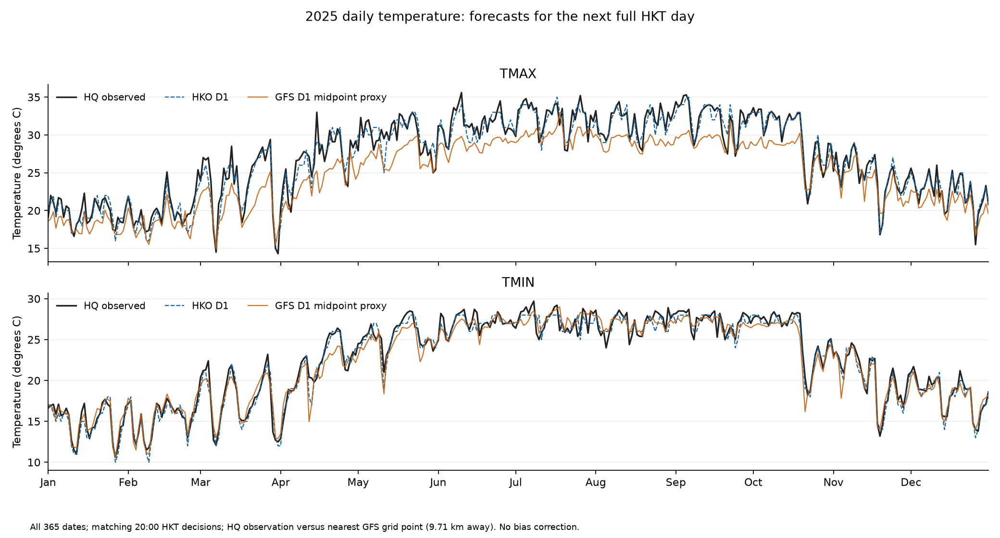
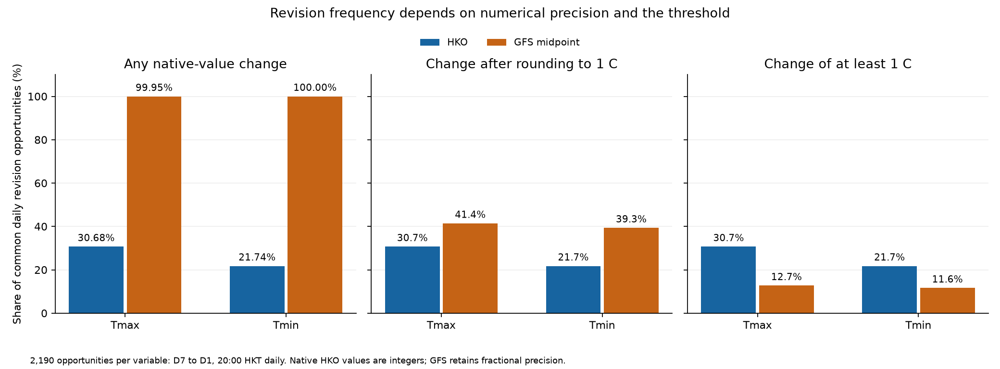
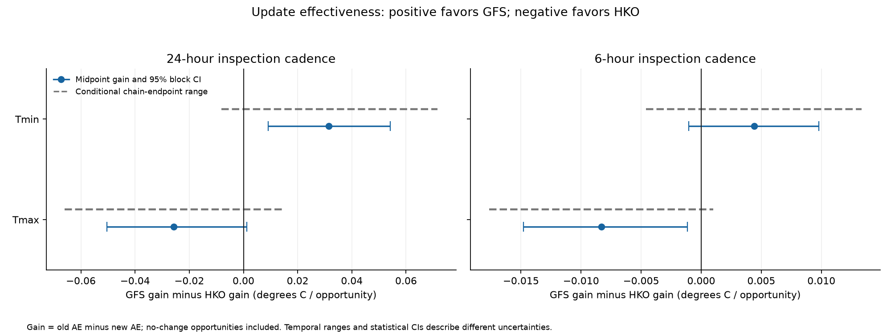

# 2025 全年温度预测与更新效果：HKO 和 GFS

2026-11-16 HKT｜参考地点：HKO Headquarters｜Task 2 回顾性产品比较。

## 可以得出的结论

**在本研究的比较规则下，HKO 的全年最高温和最低温预测都更接近总部站观测。**
主要比较覆盖 365 天、提前 1–7 天；每个温度变量有 2,555 个配对案例，共 5,110 个，没有缺测。
最高温 MAE 为 HKO **1.180°C**、GFS 中点近似 **2.622°C**；最低温分别为 **0.861°C**、**1.093°C**。
HKO 在每一个提前天数的平均误差都较小。GFS 的日最高温有明显偏冷：平均偏差 **−2.388°C**，HKO 为 **−0.194°C**。
最低温平均偏差分别为 GFS **−0.419°C**、HKO **−0.078°C**。这里没有做事后偏差校正。

**更新得多，不等于更新更有用。** GFS 几乎每次都有小数值改动；HKO 通常保持原值，改动时约六成更接近最终观测。
以日极值重建范围的中点作为 GFS 数值时，每天查看一次，GFS 的最低温修订平均改善更多；最高温没有明确差异。
每六小时查看一次，最高温结果倾向 HKO，最低温没有明确差异。**把日界线重建的不确定性也保留下来后，四项更新收益差值范围都跨零，不能稳健地宣布哪方更新整体更有效。**

这是 HKO 公开预报产品与 GFS 原始格点产品在一个站点、一年的比较。它不证明两个机构或核心数值模型在所有地点、年份的能力排名。
GFS 实际历史发布时间未核实，下面结果以明确的发布时间延迟假设为条件。

## 误差大小与全年走势

MAE 是平均绝对误差，越小越好；表内温度单位都是 °C。
“GFS−HKO”正值表示 HKO 的误差更小。中点只是 GFS 日极值的近似数值。

| 变量 | HKO MAE | GFS 中点 MAE | GFS 条件性 MAE 范围 | GFS−HKO MAE（95% CI） |
| --- | --- | --- | --- | --- |
| 最高温 | 1.180 | 2.622 | 2.508–2.743 | 1.442 [1.169, 1.697] |
| 最低温 | 0.861 | 1.093 | 0.981–1.213 | 0.232 [0.143, 0.320] |

GFS 条件性范围不是置信区间。即使对 GFS 采用范围内最有利的极值，2025 样本的平均误差下界仍高于 HKO；这仍依赖于下述区间语义和编码余量假设。
中点误差差值的 14 天区块 CI 为最高温 [1.160, 1.733]、最低温 [0.141, 0.322]，与 7 天区块结论一致。



| 变量 | 提前天数 | HKO MAE | GFS 中点 MAE | 差值 95% CI |
| --- | --- | --- | --- | --- |
| TMAX | 1 | 0.956 | 2.444 | [1.240, 1.734] |
| TMAX | 2 | 1.046 | 2.582 | [1.262, 1.790] |
| TMAX | 3 | 1.113 | 2.635 | [1.233, 1.799] |
| TMAX | 4 | 1.162 | 2.637 | [1.199, 1.745] |
| TMAX | 5 | 1.249 | 2.641 | [1.112, 1.657] |
| TMAX | 6 | 1.337 | 2.683 | [1.056, 1.606] |
| TMAX | 7 | 1.399 | 2.734 | [1.052, 1.606] |
| TMIN | 1 | 0.696 | 0.835 | [0.047, 0.237] |
| TMIN | 2 | 0.766 | 0.938 | [0.066, 0.273] |
| TMIN | 3 | 0.803 | 1.033 | [0.110, 0.344] |
| TMIN | 4 | 0.846 | 1.105 | [0.137, 0.379] |
| TMIN | 5 | 0.934 | 1.158 | [0.113, 0.336] |
| TMIN | 6 | 0.962 | 1.235 | [0.157, 0.386] |
| TMIN | 7 | 1.019 | 1.348 | [0.206, 0.451] |



这张图使用同一批 365 天的 D1 预报，没有删掉高误差或极端温度日期。

## 更新率与更新价值

这里的“修订”是同一目标日、同一变量在两次查看之间的预测数值变化；并非公告发布次数。
主要比较每天 20:00 HKT 查看一次，从提前七天一直追踪到提前一天，每个变量共 **2,190 次配对机会**。
双方必须在前后两个时刻都有预报和共同观测。

如果只问有没有选到新的预报版本，每天查看一次，HKO／GFS 的版本更新率为
**100.0%／100.0%**；每六小时查看一次则为
**90.8%／100.0%**。
有新版但数值未变，不算温度数值修订。这是本地档案及所设可用时间规则下的选版结果，不能当作实际服务发布日志。

一次更新的收益 = 旧预报绝对误差 − 新预报绝对误差。正值表示改善，负值表示变差；保持原值的收益为零。
平均收益的分母包括全部共同机会，因此不会通过只挑“改对了”的更新来夸大效果。

| 变量 | 产品 | 数值修订率 | ≥1°C 修订率 | 修订后改善占比¹ | 每次机会平均减少误差（95% CI） |
| --- | --- | --- | --- | --- | --- |
| TMAX | HKO | 30.68% | 30.7% | 60.0% | 0.074 [0.051, 0.097] |
| TMAX | GFS | 99.95% | 12.7% | 54.5% | 0.048 [0.027, 0.069] |
| TMIN | HKO | 21.74% | 21.7% | 60.7% | 0.054 [0.034, 0.075] |
| TMIN | GFS | 100.00% | 11.6% | 56.2% | 0.085 [0.063, 0.107] |

¹ “修订后改善占比”只以发生原始数值改动的机会为分母。HKO 与 GFS 的这些子样本不同，不能把比例直接解释为同一批更新的胜率。
只看 ≥1°C 的改动时，HKO／GFS 的改善占比为最高温 **60.0%／51.8%**、
最低温 **60.7%／59.8%**。

HKO 的预报温度是整数，GFS 保留小数，原始修订率受到精度影响。把两者按同一 half-up 规则取整后，GFS 的日修订率仍为最高温
**41.4%**、最低温 **39.3%**。
但“取整后改变”和“原始数值改变至少 1°C”是两种不同口径，所以同时保留。



### 查看频率与结论稳定性

六小时查看网格为 HKT 02、08、14、20 时。提前七天 02 时的 GFS 输出需要延伸至 +196 h，超过已获取的 +192 h，
因此排除这一个时刻；实际链从 D7 08 时到 D1 20 时，共 26 次机会，每个变量 **9,490 次**。不能把六小时收益与每天收益当作相同长度的单次更新。

| 查看间隔 | 变量 | HKO 平均收益 | GFS 中点平均收益 | GFS−HKO 收益（95% CI） | 差值的条件性范围² |
| --- | --- | --- | --- | --- | --- |
| 24 小时 | TMAX | 0.074 | 0.048 | -0.026 [-0.050, 0.001] | [-0.066, 0.015] |
| 24 小时 | TMIN | 0.054 | 0.085 | 0.032 [0.009, 0.054] | [-0.008, 0.072] |
| 6 小时 | TMAX | 0.021 | 0.013 | -0.008 [-0.015, -0.001] | [-0.018, 0.001] |
| 6 小时 | TMIN | 0.016 | 0.020 | 0.004 [-0.001, 0.010] | [-0.005, 0.013] |

² 条件性范围通过整条预报链的首尾误差计算，中间误差精确抵消；比逐次放宽后再平均更紧。
它衡量日极值重建的歧义，**没有合并抽样不确定性**，与 95% bootstrap CI 不同。
这些范围已足以阻止一个不依赖中点选择的更新胜负结论。



每天更新的累计改善也可从 D7 和 D1 的误差直接核对：最高温 HKO **1.399→0.956°C**、GFS **2.734→2.444°C**；
最低温 HKO **1.019→0.696°C**、GFS **1.348→0.835°C**。GFS 最低温改善较多，同时它的起点误差也较大，D1 误差仍高于 HKO。
因此，“改善更多”不能替代“最终更准确”。这些是随目标日接近观察到的改善，不是更新频率的因果效果。

## 季节与选版时间的检查

季节表为各季节内 D1–D7 配对案例的平均。DJF 使用 2025 年的 1、2、12 月；全年都使用相同总部站观测。
最高温各季均倾向 HKO；最低温冬季的差值 CI 跨零，所以全年结果不意味着每个季节都能单独判定胜负。

| 变量 | 季节 | HKO MAE | GFS 中点 MAE | 差值 95% CI |
| --- | --- | --- | --- | --- |
| TMAX | DJF | 0.977 | 1.768 | [0.595, 1.012] |
| TMAX | MAM | 1.574 | 3.377 | [1.183, 2.402] |
| TMAX | JJA | 1.100 | 2.814 | [1.403, 2.035] |
| TMAX | SON | 1.065 | 2.510 | [0.785, 2.127] |
| TMIN | DJF | 0.719 | 0.850 | [-0.017, 0.287] |
| TMIN | MAM | 1.000 | 1.416 | [0.183, 0.633] |
| TMIN | JJA | 0.889 | 0.999 | [0.006, 0.211] |
| TMIN | SON | 0.833 | 1.102 | [0.112, 0.439] |

情景名称中的 lag 是假设 GFS 在初始化后多少小时可用。20 HKT 的 lag 4 与 6 小时选到同一批 runs；8 与 12 小时也选到同一批 runs。
在下面六种完整情景下，全年两项温度的平均误差都倾向 HKO。
每天更新的配对收益及其时间敏感性另见 `revision_contrasts.csv`，不以某个最有利的查看时刻挑选胜者。

| 情景 | 变量 | 配对案例 | HKO MAE | GFS 中点 MAE | 差值 95% CI |
| --- | --- | --- | --- | --- | --- |
| 20HKT_lag6 | TMAX | 2555 | 1.180 | 2.622 | [1.169, 1.697] |
| 20HKT_lag6 | TMIN | 2555 | 0.861 | 1.093 | [0.143, 0.320] |
| 20HKT_lag4 | TMAX | 2555 | 1.180 | 2.622 | [1.169, 1.697] |
| 20HKT_lag4 | TMIN | 2555 | 0.861 | 1.093 | [0.143, 0.320] |
| 20HKT_lag8 | TMAX | 2555 | 1.180 | 2.694 | [1.246, 1.773] |
| 20HKT_lag8 | TMIN | 2555 | 0.861 | 1.104 | [0.150, 0.338] |
| 20HKT_lag12 | TMAX | 2555 | 1.180 | 2.694 | [1.246, 1.773] |
| 20HKT_lag12 | TMIN | 2555 | 0.861 | 1.104 | [0.150, 0.338] |
| 12HKT_lag6 | TMAX | 2555 | 1.191 | 2.689 | [1.230, 1.754] |
| 12HKT_lag6 | TMIN | 2555 | 0.869 | 1.118 | [0.159, 0.337] |
| 16HKT_lag6 | TMAX | 2555 | 1.187 | 2.694 | [1.235, 1.764] |
| 16HKT_lag6 | TMIN | 2555 | 0.868 | 1.104 | [0.143, 0.330] |

## 方法与会影响解读的限制

预先固定的设计见 [PLAN.md](PLAN.md)。完整输入提取只读数据库，根目录 `.env` 提供连接，没有新增、修改或删除任何数据库记录。

- **相同目标日和观测。** 2025 HKT 00:00–24:00 的 HQ 日最高／最低温，采用 `obs_hko_daily_tmax/tmin` 中数值有效且标记 C 的观测。
  双方选取每个共同截止点前的最新版本。HKO 的公告时间和 RSS 发布时间均须不晚于截止点；档案抓取时间不作为起报时间。
- **相同决策时刻，发布时间仍有假设。** 主要截止为 20 HKT，GFS 假设延迟六小时；实际选中当日 06 UTC run。
  不同信息新旧是这个产品使用规则的一部分，不能解释成相同初始化年龄的纯模型实验。所有 GFS 历史 available-time 字段为空。
  主要样本 HKO 陈旧到上一公告日的案例为 0。
- **日界线不齐。** 既有 GFS 资料为三小时瞬时值及区间极值。完全位于目标日内的区间只覆盖 21 小时；跨日区间覆盖全天，极值却不能精确分配到午夜两侧。
  沿用一月试验：最高温的日内区间给下界、全天相交区间给上界；最低温反向。每条极值添加 max(0.02°C, 原生量化步长) 余量。
  范围不是认证的编码误差保证，也不是预测概率区间；中点与八次瞬时采样极值均作为明确标记的近似报告。
- **实际边界诊断。** 对整个已导入温度范围逐项比较瞬时值与闭区间极值，扣除双边余量后有 **755** 项差异，
  全部发生在区间起点；结束点和内部各为 **0／0**，最大余量后差异 **0.226°C**。
  这与区间起点计入方式有关的解释相容，但尚未核实其具体机制；不能据此断定数据损坏或保证连续温度路径一致。
  [逐项诊断摘要](native_consistency.json) 保留样例。条件性重建范围及其收益范围都必须带上这项限制。
- **空间代表性。** GFS 值来自 22.25°N、114.25°E，距离 HQ 约 9.71 km；并非直接在气象站测量。
  当前单点提取不能做双线性插值，也未做海拔校正。不能把偏冷直接归因于海陆或高度差异。
- **一年、单站、已探索过的研究。** 同一天的七个 lead 不独立。CI 按 365 个日历位置做循环区块 bootstrap，保留跨 lead 和产品配对，2,000 次、seed 3522，主区块 7 天，另检验 14 天。
  CI 只描述这一年天气日的变异，不覆盖跨年份或发布时间假设；分组比较未做多重检验校正。
- **与雨量研究的问题不同。** [组员的全年雨量结果](../rainfall_daily_2025/README.md) 比较 successive-nowcast／successive-run 日累积流程。
  本研究比较在目标日开始之前选定的完整日最高／最低温预报，不能混合成一个无条件的总体产品排名。

## 文件与重现

从仓库根目录运行，使用已有 `.venv`：

```powershell
.\.venv\Scripts\python.exe -m pip install -r benchmark/temperature_2025/requirements.txt
.\.venv\Scripts\python.exe -m unittest discover -s benchmark/temperature_2025 -p test_methods.py -v
.\.venv\Scripts\python.exe benchmark/temperature_2025/run_analysis.py
.\.venv\Scripts\python.exe benchmark/temperature_2025/verify_results.py
.\.venv\Scripts\python.exe benchmark/temperature_2025/build_report.py
```

连接和缓存只用于重新从源生成分析。`run_analysis.py --offline` 使用忽略提交的本地 gzip 快照。
无需数据库、只用已提交 CSV 重新核对主要结果和 CI：

```powershell
.\.venv\Scripts\python.exe benchmark/temperature_2025/verify_results.py --offline
```

| 文件 | 用途 |
| --- | --- |
| [forecast_cases.csv](forecast_cases.csv) | 全部 45,260 个情景配对案例、选版标识、观测、GFS 极值范围及中点 |
| [accuracy.csv](accuracy.csv) | 提前天数、季节、月份、时间情景的 MAE／RMSE／bias 与区块 CI |
| [revision_pairs.csv](revision_pairs.csv) | 同一目标日的前后版本、变化、收益；主要和时间敏感性情景 |
| [revision_summary.csv](revision_summary.csv)、[revision_contrasts.csv](revision_contrasts.csv) | 修订率、改善比例、收益、配对 CI、首尾抵消后的范围 |
| [coverage.csv](coverage.csv)、[excluded_cases.csv](excluded_cases.csv) | 原始可用数、共同案例数及 730 个凌晨 D7 时域排除 |
| [run_metadata.json](run_metadata.json)、[source_queries.sql](source_queries.sql) | 只读输入范围、数据与代码 hashes、固定 SQL |
| [validation.json](validation.json) | 独立核对结果：147,171 项检查，22,630 次 live SQL 选版核对，45,260 个案例重建核对 |
| [native_consistency.json](native_consistency.json) | 区间边界诊断及解读限制 |

独立验证涵盖全部误差和更新算术、分母、首尾抵消关系、主要 7／14 天区块 CI、全量选版与观测核对，以及本地输入快照的日极值重建。
它没有重新下载全年 NOAA 原始字节，也不能建立历史发布时间或认证编码误差界限。公开派生 CSV 可以复核本报告的算术；完整原始数据提取还需数据库。

## 项目内来源

[唯一数据库定义指南](../../DATABASE_AGENT_GUIDE.md)、[原 benchmark 的时间与空间限制](../README.md)、
[一月试验方法](../../analyses/11_gfs_hko_january_2025/PLAN.md)、
[原 GFS 全年导入验证](../../data_management/model_forecasts/results/gfs_2025_verification.json)。
这次分析复用已导入、带来源及校验信息的温度数据，没有新增天气下载。
