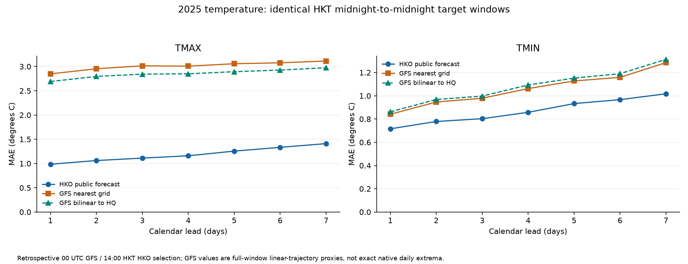
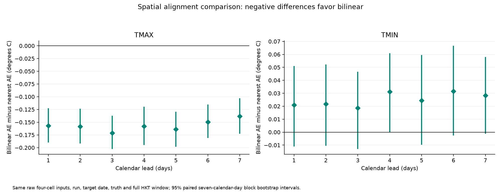
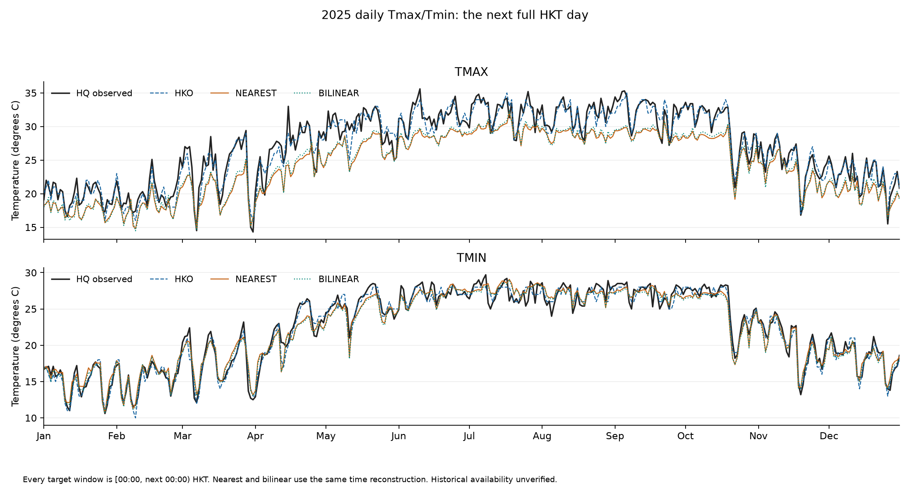
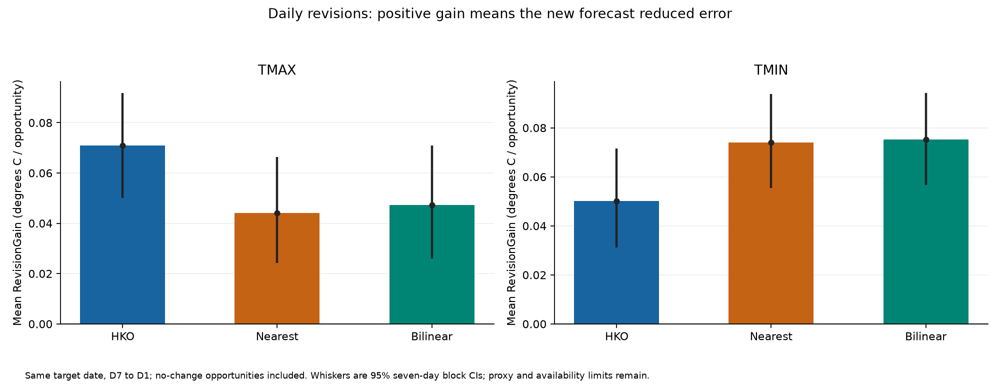

# Task 2b：按 HKT 00:00–次日 00:00 重做温度比较

2026-11-16 HKT。只修正温度分析；已有 rainfall 研究保留原样。

## 先说明这次比较的含义

**每一个目标日都从香港时间 00:00 开始，到次日 00:00 结束。**
这次 5,110 个温度案例都保存了相同定义的开始／结束时间，预报与 HQ 观测对应同一个香港自然日。
Nearest 与 bilinear 使用真实四邻点数据、同一批日期、同一个 GFS run、同一时间重建和同一条观测。

在下述可核实的回顾性选版及温度轨迹近似下，全年 D1–D7 的结果为：

| 变量 | HKO MAE | Nearest MAE | Bilinear MAE | Bilinear−HKO（95% CI） |
| --- | --- | --- | --- | --- |
| TMAX | 1.188 | 3.010 | 2.853 | 1.665 [1.410, 1.908] |
| TMIN | 0.868 | 1.057 | 1.082 | 0.215 [0.121, 0.311] |

**空间方法的直接结论：** TMAX：bilinear 的平均误差较低（空间差值 -0.157°C，95% CI [-0.185, -0.126]）。 TMIN：两种方法的平均误差差异尚不明确（空间差值 0.025°C，95% CI [-0.004, 0.054]）。
这个差值只改变空间对齐方式，比把不同日期、不同起报或不同日界线的结果放在一起更能回答 nearest 与 bilinear 的差异。

**严格基准仍有两项证据缺口：**三小时输出不能唯一恢复原生日极值；HKO 的 2026 年补抓时间及 GFS 的初始化时间也不能证明 2025 年实际可用性。
所以这里报告完整香港日的、明确标记的温度轨迹近似比较，**不宣称已经得到原生精确日极值或经历史可用性验证的全年产品优越性。**

## 00:00 窗口与选版时间分开记录

控制定义来自 Canva 实际第7页 “Task 2a — Benchmark Definition”，原文写明：
`HKO Headquarters observations`、`1 Jan–31 Dec 2025`、`HKT day: [00:00, next 00:00)`。
[定义摘录及对应关系](benchmark_source.json) 保留这次读取结果。

下表以 2025-01-01、提前一天为例。**14:00 只来自温度页的选版描述，绝不是温度统计日的起点。**

| 项目 | HKT | UTC |
| --- | --- | --- |
| 目标日开始 | 2025-01-01 00:00 | 2024-12-31 16:00 |
| 目标日结束，不含该时刻 | 2025-01-02 00:00 | 2025-01-01 16:00 |
| GFS 初始化 | 2024-12-31 08:00 | 2024-12-31 00:00 |
| HKO 选版情景截止 | 2024-12-31 14:00 | 2024-12-31 06:00 |

本次仅把第8页的 `GFS 00 UTC / HKO 14:00 HKT` 作为**单独标记的复现情景**。
HKO 选择截止前公告时间和 RSS 发布时间均有效的最新预报；不把补抓时间当起报时间。
两者预报年龄不同，不能把它解释成相同信息年龄的核心模型实验。
第7页的自然日要求始终控制预报／观测的有效窗口。

## Nearest 与 bilinear 怎样计算

HQ 坐标为 22.30194444°N、114.17416667°E。四格按 SW、SE、NW、NE 顺序为
22.25/114.00、22.25/114.25、22.50/114.00、22.50/114.25。Nearest 使用 SE，距离 HQ 约 9.71 km。
固定 bilinear 权重为 **0.24030740, 0.55191484, 0.06302592, 0.14475184**，均为非负，合计为1。

每个三小时时刻先把四格的 **2 m 瞬时温度**对齐至 HQ。随后连接成同一条分段线性时间轨迹，
在精确的 HKT 日界线裁切，再取该日轨迹的最高／最低值。两个午夜均由左右原生输出夹住，禁止外推。
对于连续轨迹，在不含次日午夜的窗口内使用午夜前的单侧极限；没有加入次日内部的极值。

没有把四格各自的日最高温／最低温直接加权后冒充“总部温度轨迹的极值”。两种运算一般不交换。
这种错误次序与本次 bilinear 结果的平均绝对差为 Tmax **0.124°C**、
Tmin **0.043°C**，仅作运算次序诊断。

| 变量 | Bilinear−nearest MAE | 95% CI（7 天块） | 95% CI（14 天块） |
| --- | --- | --- | --- |
| TMAX | -0.157 | [-0.185, -0.126] | [-0.185, -0.127] |
| TMIN | 0.025 | [-0.004, 0.054] | [-0.010, 0.059] |

差值 = bilinear 绝对误差 − nearest 绝对误差；负值倾向 bilinear，正值倾向 nearest。
置信区间来自配对日历区块 bootstrap，2,000 次、seed 3522；同一天所有 lead 和产品一起抽样。
区间反映本年天气日变异，没有消除时间重建、空间代表性及历史可用性的限制；分组比较未做多重检验校正。





| 变量 | 提前天数 | 日期数 | HKO MAE | Nearest MAE | Bilinear MAE | 空间差值 95% CI |
| --- | --- | --- | --- | --- | --- | --- |
| TMAX | 1 | 365 | 0.985 | 2.848 | 2.690 | [-0.190, -0.122] |
| TMAX | 2 | 365 | 1.061 | 2.953 | 2.795 | [-0.192, -0.123] |
| TMAX | 3 | 365 | 1.112 | 3.014 | 2.842 | [-0.203, -0.137] |
| TMAX | 4 | 365 | 1.159 | 3.007 | 2.849 | [-0.195, -0.120] |
| TMAX | 5 | 365 | 1.256 | 3.057 | 2.893 | [-0.198, -0.129] |
| TMAX | 6 | 365 | 1.333 | 3.076 | 2.926 | [-0.181, -0.115] |
| TMAX | 7 | 365 | 1.410 | 3.112 | 2.974 | [-0.172, -0.103] |
| TMIN | 1 | 365 | 0.716 | 0.841 | 0.862 | [-0.011, 0.051] |
| TMIN | 2 | 365 | 0.779 | 0.946 | 0.968 | [-0.011, 0.052] |
| TMIN | 3 | 365 | 0.803 | 0.979 | 0.998 | [-0.013, 0.047] |
| TMIN | 4 | 365 | 0.858 | 1.062 | 1.093 | [-0.000, 0.061] |
| TMIN | 5 | 365 | 0.933 | 1.128 | 1.152 | [-0.010, 0.060] |
| TMIN | 6 | 365 | 0.967 | 1.159 | 1.190 | [-0.003, 0.067] |
| TMIN | 7 | 365 | 1.017 | 1.285 | 1.314 | [-0.001, 0.058] |



## 更新得是否有效

保持目标日、变量、空间方法及选版规则不变，每天比较前后预报：D7→D6，一直至 D2→D1。
每个变量有 **2,190 个共同机会**。RevisionGain = 旧绝对误差 − 新绝对误差；正值表示改善。
平均收益的分母包括没有改变数值的机会，不只挑选改对的更新。

| 变量 | 产品 | 原始数值修订率 | ≥1°C 修订率 | 改动后改善占比¹ | 平均 RevisionGain（95% CI） |
| --- | --- | --- | --- | --- | --- |
| TMAX | hko | 27.63% | 27.6% | 60.8% | 0.071 [0.050, 0.092] |
| TMAX | nearest | 99.95% | 12.6% | 53.0% | 0.044 [0.024, 0.066] |
| TMAX | bilinear | 100.00% | 15.3% | 53.0% | 0.047 [0.026, 0.071] |
| TMIN | hko | 19.36% | 19.4% | 61.8% | 0.050 [0.031, 0.072] |
| TMIN | nearest | 99.95% | 12.1% | 56.1% | 0.074 [0.055, 0.094] |
| TMIN | bilinear | 100.00% | 11.7% | 56.8% | 0.075 [0.057, 0.094] |

¹ “改动后改善占比”只以该产品发生数值变化的机会为分母，三个产品的条件子样本不同。
HKO 是整数温度，GFS 保留小数，所以同时报告 ≥1°C 的改动率；[完整表](revision_summary.csv) 还包含共同整数精度下的修订率。
“经常变化”“变化幅度大”“更接近最终观测”分别衡量不同性质，不能互相替代。

| 变量 | 收益差值（前者−后者） | 平均差值 | 95% CI |
| --- | --- | --- | --- |
| TMAX | nearest_minus_hko | -0.027 | [-0.051, 0.001] |
| TMAX | bilinear_minus_hko | -0.024 | [-0.048, 0.004] |
| TMAX | bilinear_minus_nearest | 0.003 | [-0.002, 0.008] |
| TMIN | nearest_minus_hko | 0.024 | [0.004, 0.045] |
| TMIN | bilinear_minus_hko | 0.025 | [0.004, 0.047] |
| TMIN | bilinear_minus_nearest | 0.001 | [-0.003, 0.005] |

收益差值 CI 跨零时，不能判定平均改善谁较多。即使某项近似下的差值不跨零，仍只适用于同一重建及选版情景。
收益较大也可能来自起点误差较大，不意味着最终预报更准；验证程序另外核对了整条链的首尾误差差是否等于累计收益。



## 完整窗口与原生极值不是同一件事

这次窗口长度严格为24小时，但 GFS 在输出之间的温度并未直接观测。
我们统一使用三小时采样的连续线性轨迹作为可重复的近似；并不把它称为原生精确 Tmax/Tmin。
官方 GFS 输出在前120小时可逐小时、之后逐三小时，因此也不能假定七天都能取得逐小时原生输出。
[NOAA GFS 输出说明](https://www.emc.ncep.noaa.gov/emc/pages/numerical_forecast_systems/gfs.php)

| 变量 | 方法 | 完整日轨迹 MAE | 仅日内原生采样 MAE | 午夜处理平均改变量（°C） |
| --- | --- | --- | --- | --- |
| TMAX | nearest | 3.010 | 3.040 | 0.035 |
| TMAX | bilinear | 2.853 | 2.876 | 0.027 |
| TMIN | nearest | 1.057 | 1.052 | 0.027 |
| TMIN | bilinear | 1.082 | 1.075 | 0.028 |

此外，复用数据库已有的 nearest 原生 TMAX/TMIN 区间作时间诊断：日内完全包含的区间联合覆盖21小时，
相交区间覆盖24小时，但跨日极值无法精确分到午夜两侧。沿用已披露的 max(0.02°C, 量化步长) 余量得到：

| 变量 | Nearest 轨迹近似 MAE | Nearest 原生区间条件性 MAE 包络² |
| --- | --- | --- |
| TMAX | 3.010 | 2.580–2.816 |
| TMIN | 1.057 | 0.994–1.225 |

² 原生区间包络是带语义和编码余量假设的保守范围，不是统计 CI、不是认证编码误差界限，
也没有证明所有区间来自同一连续温度路径。这里只作为 nearest 的时间敏感性检查；没有由一个格点捏造 bilinear 原生区间。
由此不能把 GFS 与 HKO 的全部误差差距都归因于预报能力。

## 缺失、可用性与结论边界

| 检查 | 本次结果 | 可支持的解读 |
| --- | --- | --- |
| 全年 HQ 数值观测 | Tmax/Tmin 各365天，完整性 C | 同一站点、同一年真值 |
| 数值配对 | 每变量2,555；两方法相同交集 | 数值缺失率 0.0%／0.0%，低于30%门槛 |
| GFS 四邻点 | 371 runs，21,518 原始 TMP 来源 | 空间方法使用真实四格，不由单点推造 |
| Nearest 对旧导入值 | 21,518 次独立控制，差异 0 | 新提取与已有温度数据一致 |
| HKO 截止前捕获证据 | 0／2,555 个窗口 | 2026 补抓不能证明2025实际可用性 |
| GFS 历史 available time | 未建立 | 初始化时间不能充当实际发布时间 |
| 共同操作可用性已证实案例 | 0 | 不给出无条件的全年产品优越性结论 |

数值完整不等于历史可用性证据完整。严格的 archive-confirmed 结果目前不能从现有资料生成；
不能把 2026 抓取时间改写成 2025，也不能把公告时间自动称为实测接收日志。
HKO 源字段、截止点及选择结果均保留在 [逐条选版记录](vintage_selection.csv) 和 [温度案例](cases.csv)。
GFS 在 2 m 高度；HQ 站海拔记录为 32.0 m，观测传感器具体高度尚未建立。
未做高度校正或海陆代表性校正；bilinear 不会自动消除这些差异。

Canva 现有温度表的数字没有附原始选版与重建输入。本次不拿它们当真值强行拟合。
[逐项对照](slide_number_reconciliation.csv) 区分讲义旧引用与本次可复核情景；两者不一致时，应使用带来源和规则的新结果，
或者取得旧表的原始捕获证据后再解释差异。

## 核对与复现

数据库仅只读访问；没有写入或修改中央数据库。原始全球 GRIB 只在内存使用，缓存只保留四点和来源。
雨量目录的文件指纹逐一核对保持不变。

```powershell
.\.venv\Scripts\python.exe -m unittest discover -s benchmark/temperature_task2b_2025 -p test_methods.py -v
.\.venv\Scripts\python.exe benchmark/temperature_task2b_2025/read_hko.py
.\.venv\Scripts\python.exe benchmark/temperature_task2b_2025/acquire_four_cells.py --workers 16
.\.venv\Scripts\python.exe benchmark/temperature_task2b_2025/run_analysis.py
.\.venv\Scripts\python.exe benchmark/temperature_task2b_2025/verify_results.py --live --online-controls
.\.venv\Scripts\python.exe benchmark/temperature_task2b_2025/build_report.py
```

只从已提交输入与案例核对，无需数据库或下载：

```powershell
.\.venv\Scripts\python.exe benchmark/temperature_task2b_2025/verify_results.py
```

| 文件 | 用途 |
| --- | --- |
| [PLAN.md](PLAN.md)、[benchmark_source.json](benchmark_source.json) | 第7页定义与第8页选版情景分开记录 |
| [source_points.csv](source_points.csv)、[window_knots.csv](window_knots.csv) | 真实四点、原始字节来源及完整日轨迹节点 |
| [native_interval_inputs.csv](native_interval_inputs.csv) | 已导入 nearest 原生极值，供单独时间诊断 |
| [cases.csv](cases.csv)、[scores.csv](scores.csv)、[spatial_contrasts.csv](spatial_contrasts.csv) | 5,110 案例、MAE/RMSE/bias 和配对 CI |
| [revision_pairs.csv](revision_pairs.csv)、[revision_summary.csv](revision_summary.csv)、[revision_contrasts.csv](revision_contrasts.csv) | 修订前后值、幅度、收益及差值 |
| [run_metadata.json](run_metadata.json)、[validation.json](validation.json) | 输入／输出 hashes、门槛与独立核对结果 |

验证包含 69,911 项检查，全部香港日边界与四点计算、HKO 选版与真值、原始 nearest 控制、误差与修订算术、
配对区块 CI，并对12个月原始 NOAA 文件做独立的四格数组索引解码。
这些检查不认证原生完整日极值或历史可用性。旧 [20:00／单点温度实验](../temperature_2025/README.md)
只保留为不同规则下的历史实验，不能替代本次 Task 2b 的空间对齐比较。
